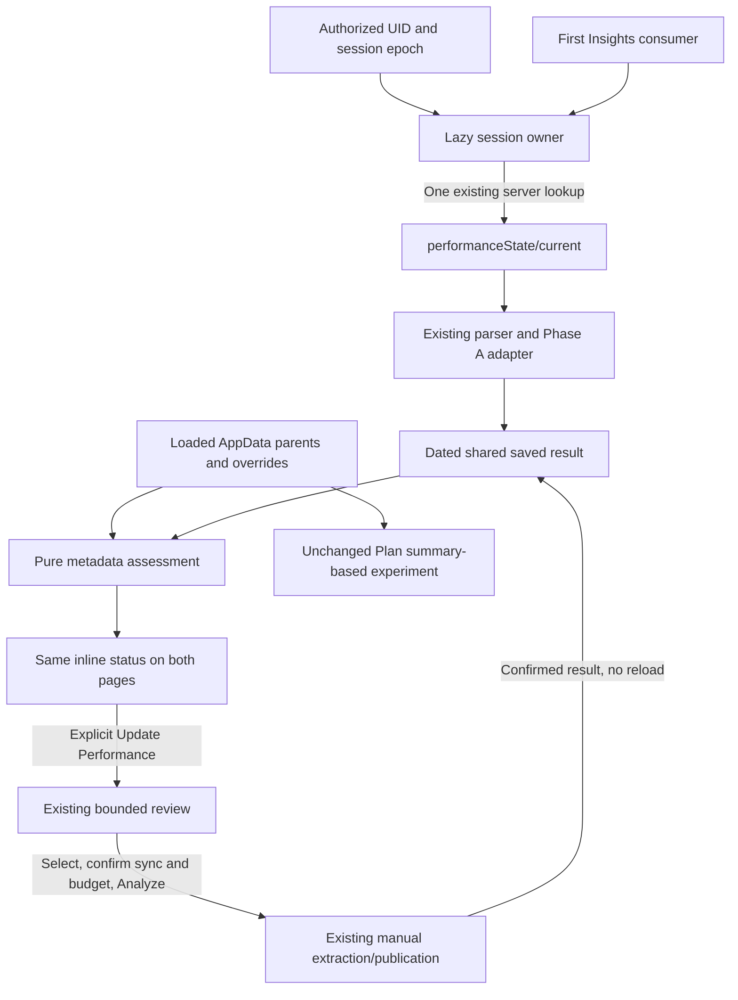

# Shared performance evidence — Phase B

Baseline: Phase A [PR #47](https://github.com/cgradbad89/training-web/pull/47),
`d95b6f50d57e6fb73bf011c337b43ced917d2e8b`. Both protected-main checks passed;
its normal Git-triggered production deployment was verified READY.

## Ownership and read policy

`PerformanceEvidenceProvider` lives inside the authenticated layout and AppData
owner, keyed by authorized UID and session epoch. Its in-memory store is dormant
until an Insights consumer mounts. The approved cold-entry policy intentionally
allows **one saved-state document lookup**, including Plan-first sessions.
Personal no longer owns a separate display lookup.

The provider uses the existing `capturePerformanceSession` and
`getSavedPerformance`: verified owner/token/session checks, server-only lookup of
`users/{uid}/performanceState/current`, existing schema parser. Concurrent callers
share a promise. Success, absence and failure remain resident across navigation;
only the explicit inline **Retry saved analysis load** action retries a failed
load. `not_loaded`, `loading`, `absent`, `available` and `error` remain distinct.

There is no singleton, listener, polling, timer, cross-tab synchronization,
localStorage persistence, new collection or background job in this layer. Logout,
same-UID re-login, epoch/owner replacement and provider disposal retire old results.
Strict Mode's synchronous replay reuses its same owner's pending request.



## Detection and limitations

`assessPerformanceFreshness` performs no acquisition, hashing, extraction or
publication. It selects the newest **300 loaded parents before run filtering**,
then checks the existing manual **180-calendar-day scope** in the saved timezone.
Canonical overrides/exclusions use existing effective values. AppData's newest
1,000 parents and source refresh behavior are unchanged. Retrieval success,
coverage, calculation cutoff/completion and retrieval time remain separate.

| State | Meaning |
| --- | --- |
| `no_saved_analysis` | Successful saved-state lookup found no result. |
| `checking` | Saved state or an initial required source is loading; a later refresh may also be pending. |
| `no_detected_changes` | No new changes detected in loaded workout records. Never a completeness guarantee. |
| `update_available` | Eligible post-cutoff runs, supported newly visible records, or observed source-value changes warrant review. |
| `incomplete_sync` | A run that ended within the last 7 days (or is unfinished) reports partial route metadata; it may still be syncing. Older `routeComplete: false` markers are historical limitations (see 2026-11-05 update below). |
| `unable_to_verify` | Failed initial/read/refresh, ambiguous historical membership or unavailable comparison/date basis. |

Reliable detections and boundaries:

- A completed eligible run after the calculation cutoff and absent from its
  incorporated manifest could not have been incorporated as completed at that
  cutoff. Excluded, non-running, invalid and unfinished records are not counted.
- Historical absence from `featureRevisions` alone is uncertain, never a claim
  of a new run. It can reflect exclusions, unavailable features, bounded coverage
  or unprocessed history. Known unresolved/rejected IDs are not called new.
- Once both sources have successfully loaded, a session observation retains
  relevant parent/override **values** for that publication. Later differences
  establish values changed **since first observed in this session**, not a
  reconstructed change since the saved calculation. Sync/override timestamps
  alone, PR badges and derived load/aggregate caches do not establish corrections.
- Newly visible older records can warrant review when absent from that observation
  and the incorporated manifest, within the prior supported population boundary.
  They are labeled newly visible in this session, not newly created. An uncovered
  prior population remains uncertain. Records outside supported scope are ignored.
- A new publication starts a new observation basis. Unchanged publication retains
  identity/basis and original timestamp. No source digest is invented or persisted.
- `routeComplete: false` and unfinished parents are known incomplete. True/absent
  flags do not verify telemetry. Silent child-only corrections, original ingestion
  watermarks, route-count/route-HR hints not retained by AppData and immutable child
  generations remain undetectable. No missing-timestamp fallback or timing tolerance
  was changed.

Same-day AppData focus/return retains the existing 30-second floor and seven-day
overlap. It cannot discover arbitrary old late inserts or removals. Existing
next-local-day/full manual reconciliation can expose older records, within the
shared/manual limits. This phase adds no broader query. Deletions absent from
current parents and race/VO₂-only corrections have no complete comparison basis
here and are not claimed to be comprehensively detected.

Failed background requests retain valid dated evidence/resident records with an
inline limitation. Known actionable changes remain visible alongside that warning.
Loading, missing data or failure never establishes no training. Partial saved
coverage remains partial even after a successful lookup.

## Workflow and numerical integrity

`PerformanceEvidenceStatus` supplies identical status/count terminology on both
pages. Plan (since 2026-11-05) shows it inside the Estimate Details modal and a
one-line tile notice; it links to the Personal panel anchor; navigation never starts review.
There are no modal prompts. The dated result stays visible while updates are
pending. PR #46 deliberate-action focus, scroll, containment, Cancel, processing,
error and completion behavior is preserved.

Review, run selection (maximum 20), sync confirmation, read-budget confirmation
(default 5,000, UI maximum 25,000) and Analyze remain explicit. Existing review,
extraction, receipt reuse, revision/conflict checks and atomic current/snapshot
publication are unchanged. No persisted contract/path or production gate changed.

Success supplies returned `update.current` directly to the shared store. A
confirmed outcome after page navigation still reaches the live authenticated
owner; after owner/unmount invalidation it is discarded. Unchanged publication
keeps the exact resident result when identity matches. Failed publication retains
the prior result and shares failure state. Existing manual review/publication
revalidation reads remain necessary. Cross-device changes do not silently reload
successful resident saved state; the next session or successful manual publication
provides a new result.

The handoff records its known client retrieval time separately from the unchanged
source calculation/commit timestamps. A detailed update already running in this
session also disables a remounted panel's review/Analyze controls until it settles,
preventing duplicate review/processing after navigation.

Plan's numerical component does not subscribe to the evidence store. It still
responds to loaded workout/race summaries, with no manual aerobic adjustment.
Actual-page tests verify manual publication does not call its estimator or change
values. Personal's aggregate/VO₂ fingerprint maintenance is unchanged and is not
proof of manual freshness. Validated capability remains unavailable and future
numerical forecasts remain withheld.

## Calls and processing costs

Measured **application-level calls**, not billed-read measurements:

| Action | Saved-state lookup calls | New feature/GPS/HR/split reads | New writes |
| --- | ---: | ---: | ---: |
| Non-Insights entry before a consumer | 0 | 0 | 0 |
| Cold entry via either page, saved or absent | 1 | 0 | 0 |
| Concurrent consumers/warm navigation | 0 additional | 0 | 0 |
| Metadata reassessment after AppData change | 0 | 0 | 0 |
| Explicit failed-load retry | 1 attempted call | 0 | 0 |
| Manual result handoff | 0 additional | 0 additional | 0 additional |

Actual SDK interception against isolated `demo-training-performance` confirms
cold/current lookup once, warm/concurrent zero additional, assessment/handoff zero
transactions/child/feature reads, and a fresh lookup after epoch replacement.
Network targets are not one-to-one with SDK calls: the SDK may retry or reuse a
transport. Missing-document billing, query minima, security-rule dependent reads,
SDK retries and manual transaction retries must be reported separately; emulator
counts are not a production bill. Existing AppData/aggregate IO and explicit manual
costs remain additional and unchanged (see `manual-performance-phase2.md`).

No new Vercel function, endpoint, job, dependency, migration, rule/index change,
backfill or iOS change. Browser assessment compares bounded parent JSON/values;
no production CPU/memory or billing benchmark is claimed.

Reproduce actual SDK/security tests using synthetic data only:

```sh
npx firebase emulators:exec --project demo-training-performance \
  --config scripts/performance-security/firebase.json --only firestore \
  'PERFORMANCE_SECURITY_EMULATOR=1 FIRESTORE_EMULATOR_HOST=127.0.0.1:8187 TZ=America/New_York npx vitest run scripts/performance-security --no-file-parallelism'
```

Browser/required checks and delivery are recorded in the completion report.
Physical iPhone Safari, VoiceOver speech, true OS suspension and deployed Console
permissions remain unverified by local/emulator testing. No production Firebase
record was read or mutated during verification. If the existing saved read is
denied in production, the owner must verify current Console rules permit the
existing verified-owner `get` of `users/{authorizedUid}/performanceState/current`.
Repository rules do not establish deployed access; no Console modification is
inferred without current rules and the verified owner UID.

Deferred stronger detection requires separately reviewed trustworthy source
revisions/ingestion receipts. Canonical numerical validation and any future race-day
forecast remain separate owner-approved work; shared evidence does not validate them.

## File manifest and local verification

Created:

- `src/types/performanceFreshness.ts` — typed assessment and session-observation inputs.
- `src/utils/performanceFreshness.ts` — pure bounded metadata assessment.
- `src/utils/performanceSessionStore.ts` — deduplicated, disposable memory owner.
- `src/contexts/PerformanceEvidenceContext.tsx` — authenticated lazy read/adapter handoff.
- `src/components/insights/PerformanceEvidenceStatus.tsx` — consistent inline status/navigation.
- `src/utils/__tests__/performanceFreshness.test.ts` — conservative detection cases.
- `src/utils/__tests__/performanceSessionStore.test.ts` — sharing, clocks, races and failures.
- `src/utils/__tests__/fixtures/savedPerformanceFixture.ts` — invented test evidence.
- `src/contexts/__tests__/PerformanceEvidenceContext.test.tsx` — real consumers, publication lifecycle and numerical isolation.
- `scripts/performance-security/sharedEvidence.integration.test.ts` — actual SDK/emulator call counts.
- `docs/shared-performance-evidence-phase-b.md` — architecture, limits, costs and verification.

Modified:

- `src/app/(app)/layout.tsx` — dormant UID/epoch owner around the authenticated shell.
- `src/app/(app)/plan-insights/page.tsx` — status sibling beside Current Performance.
- `src/components/PerformanceAnalysisPanel.tsx` — shared saved display and confirmed outcome handoff; existing workflow retained.
- `src/utils/sharedPerformanceEvidence.ts` — comment reflecting the new authorized consumer; adapters unchanged.
- `src/utils/__tests__/sharedPerformanceEvidence.test.ts` — permits only the explicit session/type boundary, retaining pure-import checks.
- `src/components/__tests__/PerformanceAnalysisPanel.test.tsx` — shared provider harness and distinct status/progress selectors; PR #46 regressions retained.
- `src/app/(app)/personal-insights/__tests__/PersonalInsightsFirestore.integration.test.tsx` — real shared provider; unchanged aggregate call-count expectations.
- `src/app/(app)/plan-insights/__tests__/PlanInsightsHydration.test.tsx` — isolates new status from existing hydration tests.
- `src/app/(app)/plan-insights/__tests__/RacePerformanceLoading.test.tsx` — isolates new status from existing source-readiness tests.
- `src/app/(app)/__tests__/layout.test.tsx` — provider boundary harness.
- `src/app/(app)/__tests__/trainingSessionLifecycle.test.tsx` — dormant persistence boundary for non-Insights lifecycle tests.
- `CLAUDE.md` — verified suite count only; temporary Next dev-generated instructions removed after shutdown.
- `PRD.md` — shared behavior, invariants, limits and completed backlog.
- `docs/shared-performance-evidence-phase-a.md` — prerequisite delivery and superseded cold-read proposal.

Local verification: 51 added cases (47 regular and four opt-in SDK cases).
Focused contract/store/assessment/consumer/panel suite: 102 passed. Full suite:
2,869 passed / 43 opt-in skipped / 2,912 total, 213 files. All 20 existing-plus-new
security/persistence/shared-evidence emulator cases passed separately. Production
Webpack build, typecheck (including a separate focused check of new test sources),
strict lint of new code and diff checks passed. Repository lint retained its 100
existing warnings and zero errors. The unchanged default Turbopack build encountered
the local PostCSS compiler IPC port-binding restriction; no build configuration
or dependency was changed to work around it.

WebKit 27.2 at 390×844 and Chromium 156 at 1280×800 passed synthetic full-page
walkthroughs: both entry orders, warm navigation, metadata refresh/new run, review
navigation without acquisition, explicit changed/unchanged publication, late and
incomplete sync, failed cold load/user retry, logout during a blocked read, shared
absence, and mobile navigation/containment. Document widths matched 390/1280;
no uncaught JavaScript error occurred. Offline transport errors were intentionally
injected. The harness fixes addressed login/navigation waits, transport targets
versus SDK calls, and advancing a fixed clock through the existing refresh floor.
Physical iPhone Safari acceptance remains **PENDING**.

## 2026-11-05 update — Plan estimate modal and incomplete-sync prioritization

**Root cause of the persistent warning.** `assessPerformanceFreshness` tested
`routeComplete === false || end > now` before checking saved-manifest membership
or the cutoff, with no recency bound. Any run in the 180-day scope that kept a
stale partial-route marker (an iOS later wake that never completed, or a flip the
seven-day AppData overlap never re-read) produced `incomplete_sync` and "Wait for
syncing" indefinitely, even when the run was already in the saved analysis and
nothing new was actionable. The marker is not proof of an active upload; parent
fields cannot establish one either way.

**Classification now.** Partial or unfinished runs that ended within
`PERFORMANCE_RECENT_INCOMPLETE_DAYS` (7) stay `incompleteWorkoutIds` and still drive
`incomplete_sync`, incorporated or not. Older ones go to
`historicalIncompleteWorkoutIds`: a disclosed limitation that does not change the
status when the run is incorporated or known-unusable. When it is neither, the
status becomes `unable_to_verify`, never "wait". Priority stays update_available >
incomplete_sync > unable_to_verify > checking > no_detected_changes. `records`
carries parent start date, type, manifest membership and after-cutoff flag for every
new, changed or incomplete ID so the details can link to `/runs/{id}`.

**Plan presentation.** The standalone Performance Evidence aside is gone from Plan.
The experimental estimate tile keeps the finish time, pace, Experimental label, race
and training basis, calculation date and latest included run. It shows a one-line
notice only for `update_available`, recent `incomplete_sync` or a failed
saved-state read. **View Estimate Details** opens an accessible dialog (bottom
sheet below `md`, centered above it, focus containment, Escape and backdrop close,
focus return, scroll lock, z-80 above the mobile tab bar). Section A is the existing
methodology content, moved and not recalculated. Section B is the shared
`PerformanceEvidenceStatus` in detailed mode: last saved analysis date, cutoff,
categorized dated runs, limitations, and the estimate-separation statement. The
panel receives these as slots, so it still imports no services. The tile notice
keeps the approved Plan cold-entry lookup (one). Opening, closing or reopening the
modal adds zero lookups and no feature, GPS, HR, split reads or writes.
